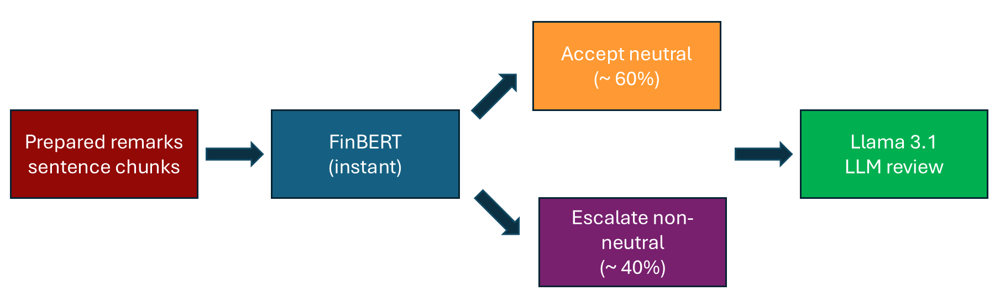

# Financial Sentiment Analysis 

## Disclaimer

* The work shared here has been submitted as a part of the Bank of England Employer Project for the Cambridge Data Science Programme. 
* To avoid potential copyright conflicts, the source files and the data processing steps have been excluded.
* The notebook and the information shared here only covers a fraction of the extended team work which I had the pleasure of contributing as well as leading.

## Project Background 

* The earnings call transcripts published by the Global Systemically Important Banks (G-SIBs) provide critical insights into their financial health 
and strategic direction which has implications for the global finance system. 
* However, the analysis of earnings call transcripts demands significant expertise and effort, as these documents typically span several pages.  
* Therefore, we must ask the question: *how can we achieve a more resource-efficient and precise financial language analysis of these transcripts ?* 

## Proposal Pitch

A system that takes raw transcript files, converts them into canonically organized signals, and creates a trackable evidence layer which can be processed and verified;
supported by a robust pipeline which:
* performs an isolated sentiment and topic analysis of the prepared remarks section,
* performs an isolated sentiment analysis of the Q&A section and checks against stock market reactions,
* flags banks and topics where negative questions go unanswered,
* performs a comprehensive Q&A anomaly detection using Isolation Forest,
* performs BERTopic attention analysis, and
* finally, joins a RAG pipeline that allows potential users to ask questions about the earnings call transcripts being analysed.

## Data Sources & Pre-processing 

The original provenance-linked corpus was constructed from 60 quarterly earnings calls from Bank 
of America, Citigroup and JP Morgan spanning 2021Q1–2025Q4. The corpus was then organised into linked data 
layers representing source provenance, canonical transcript structure, Q&A units, research views, and 
quality-control records.

## The Focussed Study Described Here

* Performs financial sentiment analysis on the prepared remarks sections in isolation using FinBERT.
* Relies on a research view where the prepared remarks sections of the 60 transcripts acquired has been filtered based on
the executive speaker, i.e. CEO or CFO.
* Captures the nuances latent within the localised statements by chunking the prepared remarks excerpts into 5 sentences.
* Consequently, preserves financial metrics and key indicators while overcoming the stricter context window of FinBERT.
* Assesses the strengths and weaknesses of FinBERT by weighing against the Llama-3.1-8B-Instruct model, configured with 4-bit quantization.
* Determines whether a cascade modelling approach combining FinBERT’s inference speed with a frontier LLM’s classification accuracy
can be adopted for the overall pipeline.

  

  

  

## Study Highlights

### FinBERT Peer Bank Classifications
The plots below show the QoQ FinBERT sentiment classification across Bank of America, Citigroup and JP Morgan, and over a 5 year time window.
While the yearly plots present a smoother, gradual change, the quarterly curves reveal sharp, immediate reactions to macro events and earnings shocks.

  

  

  

The observations are also consistent with the expectation that CEOs tend to deliver strategic, future-oriented, and vision-focused narratives, which contain 
a higher concentration of positive sentiment, whereas CFOs focus on structural facts. 

More strikingly, the average quarterly sentiment trends appear predominantly negative, with a degree of variation by bank and by quarter. This could be due to the trigger-word 
sensitivity of FinBERT towards hedging words such as ‘offset’ ‘reserve’ ‘risk’ ‘provision’ or ‘headwind’ that are heavily used in corporate language.

  

  

  

  

### FinBERT vs Llama 3.1-8B
Since Llama-3.1 was tuned using reinforcement learning from human feedback (RLHF), 
the need for a targeted fine-tuning approach (Konstantinidis et al., 2024) can be by-
passed (***but not replaced***) assuming good alignment with human preferences. Consequently, the analysis 
focuses on a direct comparison of zero-shot classification distributions across the 3 
classes. The figure below shows the quarterly sentiment trends across the 3 banks, which 
overlap only for the neutral labels. 

  

  

  

The observation is also supported by the confusion matrix plot presented below, the diagonal of which shows the recall 
scores obtained by assuming the Llama model produces the true labels. The percentages quoted in each tile suggest there is less
than 21% agreement for the negative class, roughly 43% agreement for the neutral class and finally 13% agreement for the positive class. 

  

  

  

The table below shows the bank-by-bank breakdown where we do not see much deviation from the average except for the JP Morgan case.

| Bank  | BAC | CITI | JPM 
| :---: | :---: | :---: | :---: |
| **Sentiment Label** | | **Recall Score** | |
| Negative| 0.14 | 0.17 | 0.28 |
| Neutral| 0.43 | 0.43 | 0.43 |
| Positive | 0.14 | 0.13 | 0.12 | 
| **Mean Accuracy**| 0.23  | 0.24 | 0.28 |
  
For a given class, the recall score indicates the proportion of FinBERT labels matching that of Llama labels assigned for that class. 
The mean accuracy scores (last row), give the proportion of total correct classifications made by FinBERT 
out of all predictions without focusing on a specific label.

### Topic Extraction using Llama 3.1-8B 
To understand the main themes behind the labels associated with the 5-sentence chunks, it is useful to perform a basic topic extraction from each row.
The figure below shows the evolution of the Llama-extracted topics across each bank.

  

  

  

The results show a range of topics that are discussed within the prepared remarks section which can be several pages long. As well as various financial 
metrics quoted (e.g. credit costs,CapEX spending), there are themes of strategic outlook in various financial sectors and 
markets (e.g. mergers and acqusitions, revenue growth,tax strategy).

The colour map indicates topic prevalancy and show how topics like tax strategy, revenue growth, mergers and acquisitions as well as net 
income dominate discussions QoQ, across all banks (even for the JPM CEO who rarely takes part in prepared remarks).

### Sentiment Distribution Across Extracted Topics and Hedging Words

To understand the breakdown of sentiment distributions of broad themes discussed in 
the executive remarks, the Llama-3.1 model was also used to extract the primary topics 
for a given chunk, which are visualised in panel **A** of the figure below. The prepared remarks chunks 
labelled negative by FinBERT were also searched for the top 10 hedging keywords which 
are presented in panel **B**.  

  

  

  

* The primary topics which were extracted by the Llama-3.1 model were then clustered hierarchically 
using a lightweight open-source embedding model (all-MiniLM-L6-v2) for similarity matching.

* As the labels assigned by the Llama model are predominantly positive or neutral, the occurrence of negative sentiment is 
limited only to a few topics. 

* The ‘hedging’ keywords were counted by targeting defensive words, 
most likely to be used in chunked statements labelled as negative by FinBERT. For instance, the 
word ‘offset’ appears in 281 negatively labelled chunks which makes up 21.2% of the negative 
class.  

## Summary & Conclusions
The results highlight two things, FinBERT is likely struggling with the math and is overly influenced by the presence of trigger words. 
However, the executive remarks are not spontaneous and are usually delivered with a positive outlook, which aligns better with the Llama models reasoning.
But is the Llama model itself robust to the well-known ‘sugar-coating’ problem ? This should be tested using different prompting approaches and with different LLMs. 

