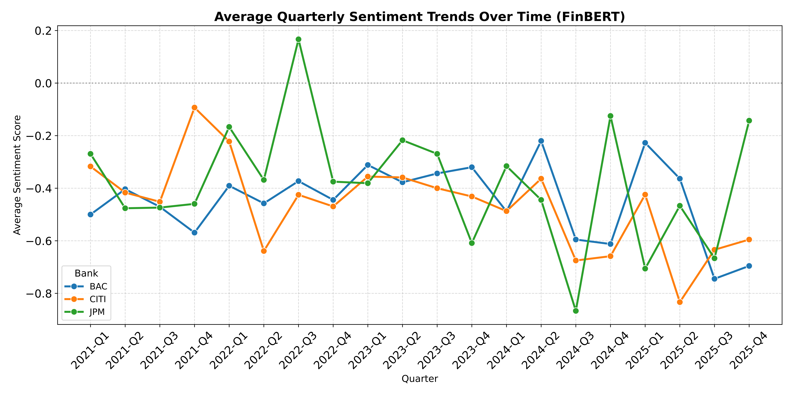
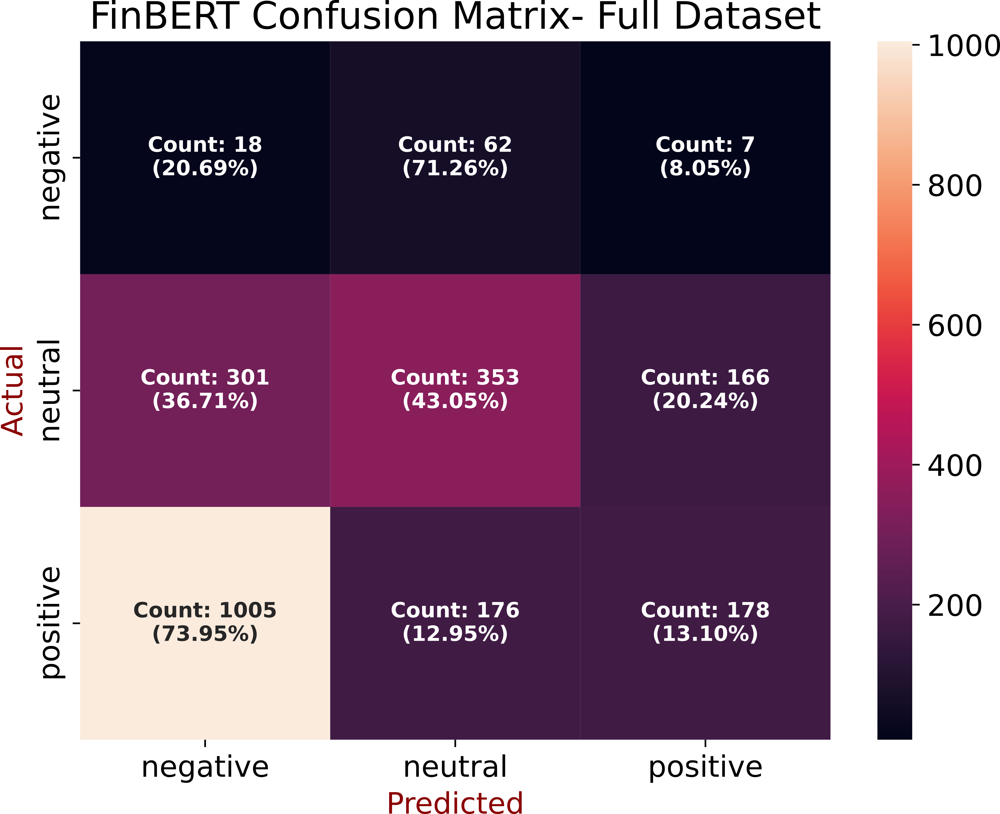
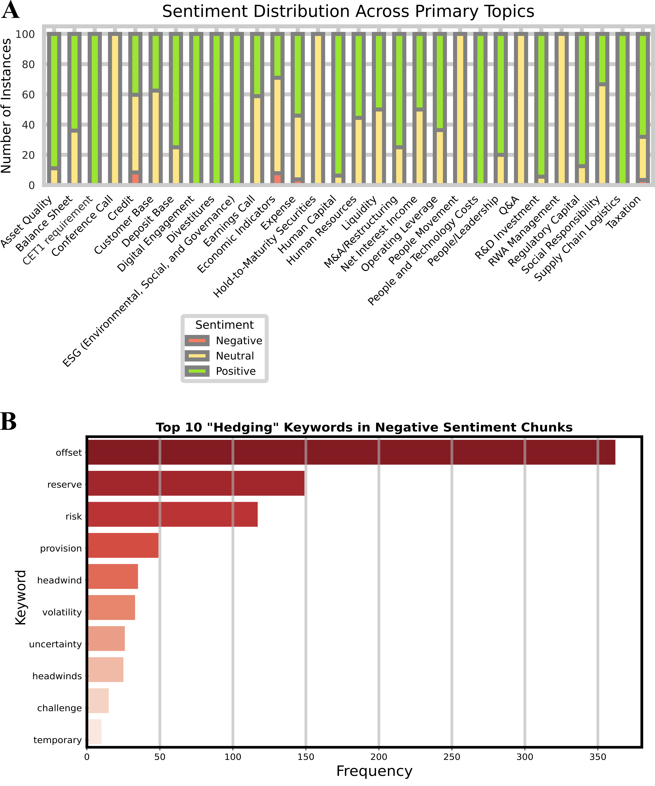

# Financial Sentiment Analysis 

## Disclaimer

* The work shared here has been submitted as a part of the Bank of England Employer Project for the Cambridge Data Science Programme. 
* To avoid potential copyright conflicts, the source files and the data processing steps have been excluded.
* The notebook and the information shared here only covers a fraction of the extended team work which I had the pleasure of contributing as well as leading.

## Project Background 

* The earnings call transcripts published by the Global Systemically Important Banks (G-SIBs) provide critical insights into their financial health 
and strategic direction which has implications for the global finance system. 
* However, the analysis of earnings call transcripts demands significant expertise and effort, as these documents typically span several pages.  
* Therefore, we must ask the question: *how can we achieve a more resource-efficient and precise financial language analysis of these transcripts ?* 

## Proposal Pitch

A system that takes raw transcript files, converts them into canonically organized signals, and creates a trackable evidence layer which can be processed and verified;
supported by a robust pipeline which:
* performs an isolated sentiment and topic analysis of the prepared remarks section,
* performs an isolated sentiment analysis of the Q&A section and checks against stock market reactions,
* flags banks and topics where negative questions go unanswered,
* performs a comprehensive Q&A anomaly detection using Isolation Forest,
* performs BERTopic attention analysis, and
* finally, joins a RAG pipeline that allows potential users to ask questions about the earnings call transcripts being analysed.

## Data Sources & Pre-processing 

The original provenance-linked corpus was constructed from 60 quarterly earnings calls from Bank 
of America, Citi and JPMorgan spanning 2021Q1–2025Q4. The corpus was then organised into linked data 
layers representing source provenance, canonical transcript structure, Q&A units, research views, and 
quality-control records.

## Study Described Here 

* Performs financial sentiment analysis on the prepared remarks sections in isolation using FinBERT.
* Relies on a research view where the prepared remarks sections of the 60 transcripts acquired has been filtered based on
the executive speaker, i.e. CEO or CFO.
* Captures the nuances latent within the localised statements by chunking the prepared remarks excerpts into 5 sentences.
* Consequently, preserves financial metrics and key indicators while overcoming the stricter context window of FinBERT.
* Assesses the strengths and weaknesses of FinBERT by weighing against the Llama-3.1-8B-Instruct model, configured with 4-bit quantization.
* Determines whether a cascade modelling approach combining FinBERT’s inference speed with a frontier LLM’s classification accuracy
can be adopted for the overall pipeline.

  

  

  

## Study Highlights

### FinBERT Peer Bank Classifications
  

  

  

  

  

  

  

### FinBERT vs Llama 3.1-8B

  

  

  

  

  

  

| Bank  | BAC | CITI | JPM 
| :---: | :---: | :---: | :---: |
| **Sentiment Label** | | **Recall Score** | |
| Negative| 0.14 | 0.17 | 0.28 |
| Neutral| 0.43 | 0.43 | 0.43 |
| Positive | 0.14 | 0.13 | 0.12 | 
| **Mean Accuracy**| 0.23  | 0.24 | 0.28 |
  
  
Confusion matrix plots were included to encapsulate the classification process. 

### Topic Extraction using Llama 3.1-8B 

  

  

  

### Sentiment Distribution Across Extracted Topics and Hedging Words

  

  

  

## Summary & Conclusions
The results highlight two things, FinBERT is likely struggling with the math and is overly influenced by the presence of trigger words. 
However, the executive remarks are not spontaneous and are usually delivered with a positive outlook, which aligns better with the Llama models reasoning.
But is the Llama model itself robust to the well-known ‘sugar-coating’ problem ?  
This should be tested using different prompting approaches and with different LLMs. 

